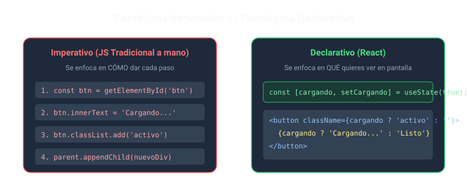
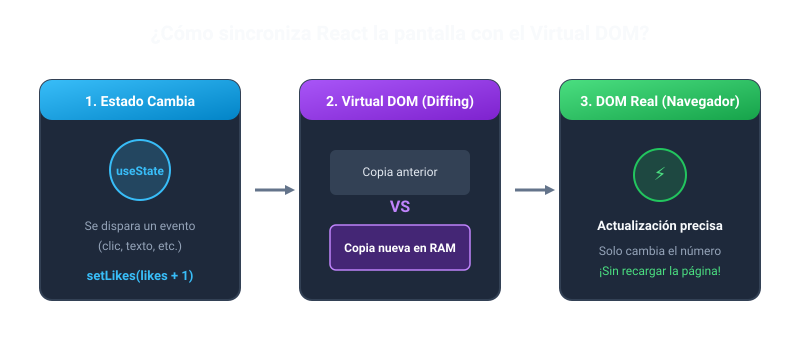
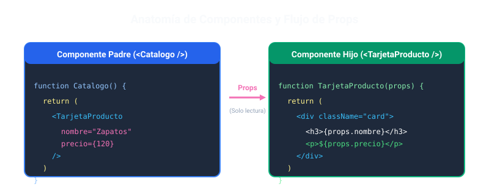

# Taller 2 - Segundo Corte: React
* **Estudiante:** Juan Francisco De Avila Alfaro
* **Materia:** Desarrollo Frontend
* **Modalidad:** Individual
* **Fecha de entrega:** 16 de octubre de 2026
---
## Punto 1 · ¿Qué es React?
### ¿Qué es React y para qué sirve dentro del desarrollo web?
React es una herramienta de JavaScript que se usa para armar la parte visual (la interfaz) de las páginas web. Básicamente, sirve para hacer páginas interactivas donde las cosas cambian en la pantalla sin necesidad de que la página se tenga que recargar entera a cada rato (lo que conocemos como SPA). La idea principal de React es que armas tu web dividiéndola en pedacitos o piezas sueltas (componentes) como botones, barras de navegación o tarjetas, y luego los juntas todos.

### ¿Quién lo creó y en qué año apareció?
Lo creó **Jordan Walke**, que era un programador de **Facebook** (hoy Meta). 
* Primero lo crearon de forma interna en 2011 para solucionar problemas que tenían con el muro de noticias de Facebook.
* Luego lo usaron en Instagram en 2012.
* Finalmente lo abrieron al público (código abierto) en **mayo de 2013** en una conferencia de JavaScript (JSConf US).
### ¿Es una librería o un framework? Explica la diferencia y justifica tu respuesta
**React es una librería**, no un framework.
La diferencia principal está en quién manda a quién (lo que llaman inversión de control):
* **En un framework (como Angular):** El framework es como una casa prefabricada con reglas estrictas. Te dice exactamente cómo ordenar las carpetas, cómo hacer las rutas y cómo llamar a las APIs. El framework maneja tu código.
* **En una librería (como React):** React es más bien como una herramienta específica de tu caja de herramientas. Solo se encarga de pintar cosas en la pantalla (la vista). Tú decides qué estructura ponerle a tu proyecto, qué usar para cambiar de página (rutas) o cómo traer los datos de internet. 
Por eso es una librería: no te resuelve la vida entera del proyecto, solo se enfoca en hacer la interfaz de usuario.
### ¿Qué significa que React sea declarativo?
Significa que tú solamente le dices a React **qué quieres que se vea** según los datos que tengas en ese momento, y React se encarga por detrás de hacer todo el trabajo sucio en el navegador.
* **Modo imperativo (JS normal):** Tienes que decirle paso a paso: "busca el botón con id tal, cámbiale el color a rojo, crea un párrafo, cárgale este texto y mételo al final del div".
* **Modo declarativo (React):** Tú simplemente dices: "si la variable `sesionIniciada` es verdadera, muestra el saludo; si es falsa, muestra el botón de login". Tú solo piensas en el resultado final.
---
## Punto 2 · ¿Qué problema resuelve React?
### ¿Cuál era la dificultad principal de construir interfaces con JavaScript "a mano" (manipulando el DOM)?
El problema de usar JavaScript puro (`document.getElementById`, `innerHTML`, `appendChild`) en páginas grandes era que se volvía un dolor de cabeza inmanejable:
1. **El código se volvía un espagueti:** Si un dato cambiaba (por ejemplo, los productos del carrito de compras), te tocaba acordarte de cambiar el número en el ícono del carrito, actualizar el total a pagar y modificar la lista de productos manualmente. Si se te pasaba uno, la pantalla quedaba mostrando datos equivocados.
2. **Era lento:** Cada vez que tocas el DOM a mano, el navegador gasta recursos recalculando el diseño y redibujando la pantalla. Si hacías muchos cambios seguidos, la página se sentía pesada o lagueada.

### Explica la diferencia entre el enfoque imperativo y el enfoque declarativo
* **Imperativo (El CÓMO):** Como cuando le das indicaciones de manejo a alguien: "avanza 2 cuadras, cruza a la derecha, frena, sube la ventana". Le dices cada pasito que tiene que hacer el navegador.
* **Declarativo (El QUÉ):** Como pedir un taxi por aplicación: "llévame a la universidad". No le dices al conductor cómo meter los cambios ni por qué calle exacta meterse; tú solo pides el resultado y React se encarga de la ruta.
### ¿Cómo ayuda React a mantener la interfaz sincronizada con los datos (el estado)?
React lo soluciona usando algo llamado **Virtual DOM**:
1. React tiene una copia ligera de la página guardada en la memoria RAM.
2. Cuando algún dato de tu página cambia, React dibuja una nueva copia en memoria con ese cambio.
3. Compara la copia vieja con la nueva (un proceso que llaman *Diffing*).
4. Se da cuenta de cuál fue la única cosita que cambió (por ejemplo, solo cambió un numerito) y va al navegador real a cambiar únicamente ese numerito, sin tener que recargar ni tocar el resto de la página.

### ¿Qué rol juegan los componentes reutilizables en la solución de ese problema?
Permiten no tener que repetir código una y otra vez. En vez de copiar y pegar el mismo bloque HTML de una tarjeta de producto 20 veces, creas un solo componente `<Tarjeta />` y lo usas las veces que quieras pasándole los datos de cada producto. Si mañana quieres cambiarle el color al botón de la tarjeta, lo cambias en un solo archivo y se arregla en toda la web automáticamente.

## Punto 3 · Principales componentes de React

### 1. Componentes
* **Definición:** Son como piezas de Lego de código. Básicamente son funciones normales de JavaScript que devuelven lo que se va a ver en la pantalla.
* **Características:**
  * El nombre de la función siempre tiene que empezar con **mayúscula** (ejemplo: `MiBoton()`) para que React no lo confunda con una etiqueta HTML normal.
  * Son independientes: lo que pasa dentro de un componente no daña a los otros.
  * Se pueden anidar (meter componentes dentro de otros).
* **Ejemplo de código:**
```jsx
// 1. Declaración del componente Aviso
function Aviso() {
  return (
    <div className="alerta">
      <h4>Atención requerida</h4>
      <p>Asegúrese de guardar las modificaciones antes de cerrar.</p>
    </div>
  );
}
// 2. Componente principal que integra a Aviso
export default function App() {
  return (
    <main>
      <h1>Panel de Configuración</h1>
      {/* Invocación del componente Aviso */}
      <Aviso />
    </main>
  );
}
```

### 2. JSX
* **Definición:** Es una forma de escribir código que mezcla HTML dentro de JavaScript. Hace que armar las pantallas sea mucho más cómodo y visual.
* **Características:**
    * Aunque parece HTML, no lo es. Por debajo se transforma en código JavaScript normal.
    * Todo lo que devuelvas tiene que estar envuelto en una sola etiqueta padre (o usar etiquetas vacías <> </>).
    * En vez de class se escribe className (porque class ya es una palabra reservada de JS).
    * Si quieres meter variables o lógica de JavaScript dentro del diseño, solo las pones entre llaves {}.
* **Ejemplo de código:**
  
```jsx
export default function TarjetaUsuario() {
  const usuario = "Carlos";
  const puntos = 150;
  return (
    <div className="tarjeta-puntos">
      <h2>Bienvenido, {usuario}</h2>
      <p>Puntos bonificados acumulados: {puntos * 2}</p>
    </div>
  );
}
```
### 3. Props
* **Definición:** Son datos o información que le mandas a un componente desde afuera (de un componente padre a uno hijo), muy parecido a cuando le pasas argumentos a una función.
* **Características:**
    * Van en una sola dirección: siempre viajan de padre a hijo.
    * Son de solo lectura: el componente que las recibe no las puede modificar por su cuenta.
    * Puedes pasar de todo: textos, números, objetos o funciones.
* **Ejemplo de código:**
```jsx
// Componente hijo que recibe las propiedades 'texto' y 'color'
function BotonAccion({ texto, color }) {
  return (
    <button style={{ backgroundColor: color, color: 'white', padding: '10px' }}>
      {texto}
    </button>
  );
}
// Componente padre que utiliza BotonAccion con diferentes configuraciones
export default function BarraHerramientas() {
  return (
    <div>
      <BotonAccion texto="Guardar cambios" color="green" />
      <BotonAccion texto="Eliminar registro" color="red" />
    </div>
  );
}
```

### 4. Estado (useState)
* **Definición:** Es la memoria propia que tiene un componente para acordarse de cosas que pueden cambiar mientras el usuario usa la página (como un texto escrito, un contador o si un menú está abierto o cerrado).
* **Características:**
    * Se usa la función useState().
    * Te devuelve dos cosas en una lista: el valor de la variable y una función especial para cambiar ese valor.
    * Cada vez que usas esa función para cambiar el dato, React se da cuenta y vuelve a pintar el componente con el nuevo valor.

* **Ejemplo de código:**
```jsx
import { useState } from 'react';
export default function ContadorMeGusta() {
  // Declaración del estado: likes (valor actual) y setLikes (función actualizadora)
  const [likes, setLikes] = useState(0);
  function darLike() {
    setLikes(likes + 1);
  }
  return (
    <div>
      <p>Total de reacciones: {likes}</p>
      <button onClick={darLike}>Reaccionar 👍</button>
    </div>
  );
}
```
### 5. Eventos (onClick, onChange)
* **Definición:** Es la manera en que React se entera de las cosas que hace el usuario (hacer clics, teclear, enviar un formulario) y ejecuta una función de respuesta.
* **Características:**
    * Se escriben con mayúscula intermedia (camelCase): onClick, onChange, onSubmit.
    * Tienes que pasarle la función sin ejecutar (sin poner los paréntesis ()), para que solo se dispare cuando el usuario haga la acción.
Ejemplo de código:
```jsx
import { useState } from 'react';
export default function EntradaTexto() {
  const [mensaje, setMensaje] = useState('');
  // Función manejadora que extrae el texto ingresado
  function alEscribir(e) {
    setMensaje(e.target.value);
  }
  return (
    <div>
      <input 
        type="text" 
        placeholder="Escriba un texto..." 
        value={mensaje}
        onChange={alEscribir} 
      />
      <p>Contenido procesado: {mensaje}</p>
    </div>
  );
}
```

## Punto 4 · Importancia de React en la industria
### ¿Por qué tantas empresas eligen React para sus productos web?
A las empresas les gusta porque ahorra tiempo y plata. Al poder reutilizar componentes, los equipos de diseño y desarrollo crean "sistemas de diseño" que usan en varios productos a la vez. Además, como es tan conocido, cuando una empresa necesita contratar un desarrollador front-end es mucho más fácil encontrar a alguien que ya sepa React que buscar a alguien de tecnologías menos usadas.

### ¿Qué aporta React al ecosistema de desarrollo?
React cambió totalmente la forma de programar en la web y creó un ecosistema gigante alrededor:

* Creó la base para frameworks más grandes como Next.js o Remix, que sirven para hacer páginas completas con buen posicionamiento en Google (SEO).
* Con **React Native**, un programador web puede usar prácticamente lo mismo que aprendió en React para hacer aplicaciones móviles para Android y iPhone.
* Hay miles de librerías hechas por la comunidad en `npm` listas para usar: cosas para formularios, tablas, animaciones o manejo de datos.

### ¿Qué papel juegan su comunidad y su mantenimiento?
Es clave porque React no es un proyecto abandonado. Lo mantiene activamente un equipo de ingenieros pagos dentro de **Meta** (Facebook), junto a ingenieros de empresas como Vercel y un montón de colaboradores libres. Además, la comunidad es inmensa: si tienes un error o duda rara, lo buscas en Google o foros y es casi seguro que a otra persona ya le pasó y está resuelto.

### ¿Por qué es una habilidad relevante para un desarrollador front-end hoy en día?
Porque si buscas empleo de front-end en portales de trabajo (LinkedIn, Get on Board, etc.), la gran mayoría de ofertas piden saber React como requisito principal o deseable. Además, aprender React te enseña a pensar la web en componentes y manejar datos de forma ordenada, lo que te hace mejor programador en general.


## Punto 5 · Grandes empresas que utilizan React

### 1. Netflix

**¿En qué producto o sección lo usan?**

Netflix ha documentado el uso de React en el desarrollo de la interfaz de usuario de su aplicación para televisores inteligentes (*Smart TVs*) y otros dispositivos de reproducción multimedia.

**¿Por qué es un caso relevante?**

Los televisores inteligentes pueden tener menos capacidad de procesamiento y memoria que un computador convencional. Por esta razón, desarrollar interfaces rápidas y fluidas representa un desafío para los equipos de ingeniería.

En un artículo técnico publicado en enero de 2017, Netflix explicó cómo desarrolló una solución llamada **React-Gibbon**. Esta implementación adaptaba React a Gibbon, un motor gráfico utilizado por Netflix para representar su interfaz en dispositivos de televisión, en lugar de depender del DOM tradicional del navegador.

Gracias a esta arquitectura, los desarrolladores podían construir interfaces mediante componentes declarativos de React y aplicar optimizaciones para mejorar el rendimiento en dispositivos con recursos limitados.

Este caso demuestra que React puede adaptarse a diferentes entornos de ejecución y que la optimización del código es importante para ofrecer una buena experiencia de usuario.

* **Fuente:**

    * Netflix Technology Blog. [Crafting a high-performance TV user interface using React](https://medium.com/netflix-techblog/crafting-a-high-performance-tv-user-interface-using-react-3350e5a6ad3b).

### 2. Airbnb
**¿En qué producto o sección lo usan?**

Airbnb ha compartido experiencias técnicas relacionadas con la arquitectura frontend de su plataforma web y el desarrollo de interfaces mediante componentes reutilizables.

**¿Por qué es un caso relevante?**

Una plataforma de alojamiento y viajes necesita mantener una experiencia coherente en diferentes secciones, como las búsquedas de propiedades, las fichas de alojamientos y los procesos de reserva. A medida que una aplicación crece, organizar el código y facilitar la colaboración entre desarrolladores se vuelve cada vez más importante.

React permite dividir una interfaz en componentes independientes que pueden reutilizarse y mantenerse con mayor facilidad. Airbnb también ha compartido herramientas y convenciones de programación con la comunidad, entre ellas su guía de estilo de JavaScript y sus recomendaciones para React y JSX.

Este caso permite comprender cómo los componentes reutilizables y las buenas prácticas de programación ayudan a organizar aplicaciones web complejas.


* **Fuentes:**
    * Airbnb Engineering. [Rearchitecting Airbnb’s Frontend (Archivo Web)](https://web.archive.org/web/20201208162910/https://medium.com/airbnb-engineering/rearchitecting-airbnbs-frontend-5e213efc24d2).
    * Airbnb. [JavaScript Style Guide](https://github.com/airbnb/javascript).
    * Airbnb. [React/JSX Style Guide](https://github.com/airbnb/javascript/tree/master/react).
* **Fuentes bibliográficas:**
    * React. Documentación oficial. [Describing the UI](https://es.react.dev/learn/describing-the-ui). Consultada para estudiar los componentes, JSX y la organización de las interfaces.
    * React. Documentación oficial. [State: A Component's Memory](https://es.react.dev/learn/state-a-components-memory). Consultada para comprender el estado de los componentes y el funcionamiento de useState.
    * React. Equipo de desarrollo. [React Team](https://es.react.dev/community/team). Consultada para conocer el equipo y la comunidad que participan en el desarrollo y mantenimiento de React.
    * Netflix Technology Blog. [Crafting a high-performance TV user interface using React](https://medium.com/netflix-techblog/crafting-a-high-performance-tv-user-interface-using-react-3350e5a6ad3b). Fuente técnica sobre React-Gibbon y la optimización de interfaces para dispositivos de televisión.
    * Airbnb Engineering. [Rearchitecting Airbnb’s Frontend (Archivo Web)](https://web.archive.org/web/20201208162910/https://medium.com/airbnb-engineering/rearchitecting-airbnbs-frontend-5e213efc24d2). Fuente relacionada con la evolución de la arquitectura frontend de Airbnb.
    * Airbnb. [JavaScript Style Guide](https://github.com/airbnb/javascript). Recurso sobre convenciones y buenas prácticas para escribir código JavaScript.
    * Airbnb. [React/JSX Style Guide](https://github.com/airbnb/javascript/tree/master/react). Recurso con recomendaciones de estilo para desarrollar componentes React y utilizar JSX.
    * Wikipedia. [React](https://es.wikipedia.org/wiki/React)
